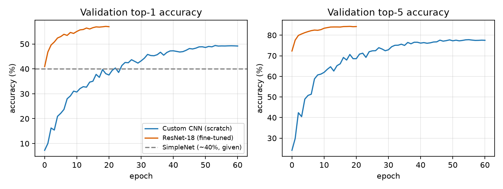
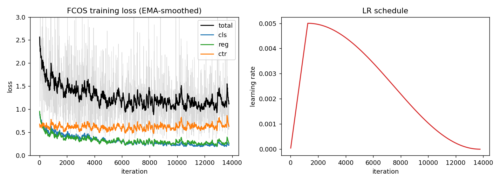

# BMI/CS 771 — Homework 2 Report

**Team:** Ashvin, Akshat, Shubhangi

---

## Part I — Image Classification (MiniPlaces)

### I.1 Custom CNN
We replaced the provided SimpleNet (a shallow 7×7-conv network with no normalization, ~0.37M parameters) with `CustomNet`, a small ResNet-style network (~11.2M parameters) in `cls_libs/modeling.py`. The three changes aimed at the baseline's weaknesses are:
- **BatchNorm** after every convolution, which stabilizes training and permits a large learning rate.
- **Skip connections.** The body is eight residual `BasicBlock`s (two 3×3 convs each), with a 1×1 projection on the skip path whenever the stride or channel count changes.
- **More depth.** Four stages of two blocks each, with widths 64/128/256/512 and stride-2 downsampling at the start of stages 2–4.

A 3×3 stride-2 conv plus max-pool stem takes the 128×128 input to 32×32. Global average pooling, dropout (0.2) and a linear classifier finish the network. Convolutions use Kaiming initialization, and the last BatchNorm of each residual branch is zero-initialized so every block starts as an identity mapping.

**Training scheme.** Provided pipeline and defaults: SGD (momentum 0.9, weight decay 1e-4), learning rate 0.1 with one warmup epoch then a cosine schedule, batch size 512, fp16, 60 epochs, random crop to 128×128 with color jitter and rotation augmentation. Training ran on a single GPU on CHTC.

**Results** (MiniPlaces validation set):

| | Top-1 | Top-5 |
|---|---|---|
| Custom CNN, final epoch | 49.18 | 77.51 |
| Custom CNN, best epoch | 49.38 | 77.80 |

Validation accuracy plateaus over the last ~10 epochs as the cosine schedule decays. Training accuracy (mean of the last five logged batches) is ~66% top-1 against 49% on validation, so the network overfits. Further regularization (stronger weight decay or dropout) is the obvious next step; we did not run it.

Files: config `results/cls_cnn/cls_miniplaces_cnn.yaml`, logs `results/cls_cnn/tensorboard/` and `config.txt`, final checkpoint `results/cls_cnn/model_final.pth.tar`.

### I.2 Self-Attention and Transformer Block
*(Shubhangi — brief explanation of multi-head self-attention and the local-window Transformer block.)*

### I.3 Vision Transformer
*(Shubhangi — SimpleViT design, training scheme, results; include config, logs, final checkpoint.)*

### I.4 Comparison

*Figure: Validation accuracy of the custom CNN (trained from scratch, 60 epochs) and fine-tuned ResNet-18 (20 epochs). SimpleNet is shown as the ~40% top-1 reference given in the assignment; we did not train it.*

| Model | Initialization | Params | Epochs | Top-1 | Top-5 |
|---|---|---|---|---|---|
| SimpleNet (provided) | scratch | ~0.37M | – | ~40 (as given) | not reported |
| Custom CNN | scratch | ~11.2M | 60 | 49.18 | 77.51 |
| ResNet-18 | ImageNet-pretrained, fine-tuned | ~11.2M | 20 | 56.94 | 84.18 |

Our CNN improves on SimpleNet by about 9 points top-1. Part of this gain comes from BatchNorm and skip connections, which make the deeper network trainable, and part from the much larger capacity, so the comparison does not isolate either factor. Fine-tuned ResNet-18 is the best of the three, about 8 points above our CNN, even though it trained for a third as many epochs. It has nearly the same architecture and parameter count, so the gap is explained by ImageNet pretraining, not model design: the pretrained network starts at ~41% top-1 after the first epoch, while ours starts near 7% and needs about 20 epochs to pass SimpleNet's level. ResNet-18 fine-tuning used lr 0.01 and the same optimizer, schedule and augmentation as the CNN run; its files are in `results/cls_resnet18/`.

---

## Part II — Object Detection (FCOS)

We implemented FCOS, an anchor-free one-stage detector. The starter code provides the ResNet backbone, FPN with extra P6/P7 levels, the shared heads, the point generator, and the train/eval pipeline. We filled in the two missing components in `det_libs/modeling.py`: inference and the training loss.

### II.1 Inference

Inference runs per image. For each FPN level we compute an object score of `sqrt(sigmoid(cls) · sigmoid(center-ness))`, drop candidates below `score_thresh = 0.1`, and keep the top 1000 by score. The regression head predicts the four distances `(l, t, r, b)` to the box sides in grid units, so we scale them by the level stride and form each box as `(x−l, y−t, x+r, y+b)` around the point. Boxes are clipped to the image and tiny boxes removed. We then merge all levels, apply per-class NMS (`nms_thresh = 0.6`), and keep the 100 highest-scoring detections. Class indices are shifted by `+1` to reverse the label offset applied at data loading.

On the provided pretrained ResNet-18 model (VOC 2007 test):

| Metric | Result |
|--------|--------|
| mAP@0.5 | 0.609 |
| mAP@[0.5:0.95] | 0.330 |
| Inference time | ~146 s |

This matches the expected 60.9%, confirming the decoding is correct.

### II.2 Training Loss

For each image we assign targets to every feature point, vectorized over points × GT boxes. A point is positive for a box when it falls inside a center-sampling window (`1.5 × stride`, clamped to the box) and the largest of its four distances lies within that level's regression range. Points matching several boxes take the smallest-area one.

Three losses, each normalized by a running mean of the positive count:
- **Classification** — sigmoid focal loss (α=0.25, γ=2) over all points.
- **Regression** — GIoU over positive points, between decoded and ground-truth boxes.
- **Center-ness** — BCE over positive points, target `sqrt((min(l,r)/max(l,r))·(min(t,b)/max(t,b)))`.

Training settings (default config):

| | |
|---|---|
| Backbone | ResNet-18, ImageNet-pretrained, BN frozen |
| Neck | FPN (256-d) + P6/P7, strides [8,16,32,64,128] |
| Input | scale jitter {256,288,320}, max side 480 |
| Optimizer | SGD, momentum 0.9, weight decay 1e-4 |
| LR | 5e-3, cosine, 1 warmup epoch |
| Epochs / batch | 10 (+1 warmup) / 4 |
| GPU | single T4 |

Training took about 24 minutes. The total loss fell from roughly 2.5 to 1.1; classification and regression settle near 0.25 and center-ness near 0.6.

*Figure 1: Training losses (total, classification, regression, center-ness) and the warmup–cosine learning-rate schedule.*

Results on VOC 2007 test:

| Metric | Ours | Pretrained |
|--------|------|------------|
| mAP@0.5 | 0.593 | 0.609 |
| mAP@[0.5:0.95] | 0.321 | 0.330 |
| mAP@0.75 | 0.312 | 0.322 |
| AP small/med/large | 0.046 / 0.169 / 0.409 | 0.078 / 0.201 / 0.406 |

Our model reaches 59.3% mAP@0.5, about 1.6 points below the pretrained reference. The difference comes from a lighter schedule — batch 4, lr 5e-3, 10 epochs, 480-px input versus the reference's batch 32, lr 0.02, 12 epochs, 640-px input. Accuracy is highest on large objects and lowest on small ones, as expected at this input resolution.

*Figure 2: Sample detections on the test set, showing correct localization across categories and scene types.*

---

## Contributions
- **Akshat** — Object detection (FCOS inference and training loss), repository/infra setup.
- **Ashvin** — Custom CNN design and training (`CustomNet`), fine-tuned ResNet-18 run, CHTC job setup, CNN vs. SimpleNet vs. ResNet-18 comparison.
- **Shubhangi** — *(self-attention, Transformer block, Vision Transformer)*

## Additional packages
Beyond the required packages, we used: `opencv-python-headless`, `matplotlib` (for plots), and `fonts-freefont-ttf` (so `eval_det.py -v` can render label fonts on a headless server).
