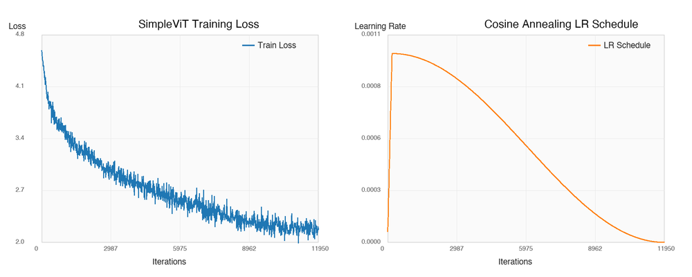
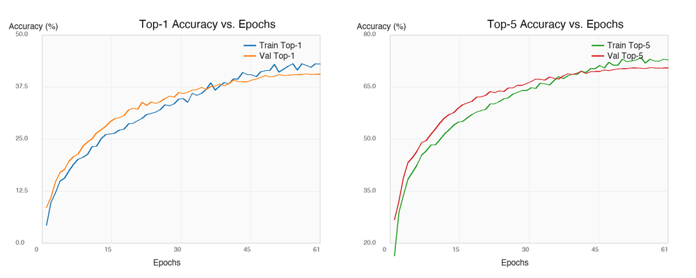
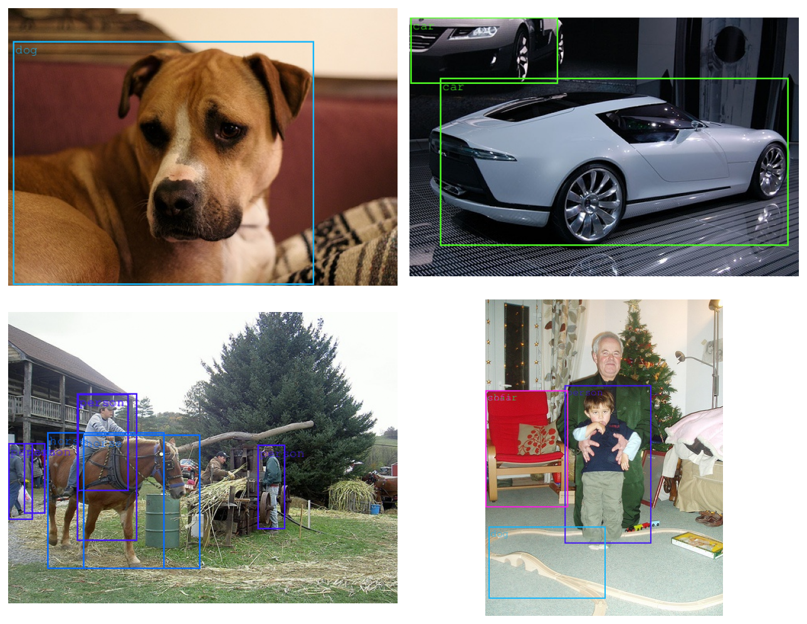

# BMI/CS 771 — Homework 2 Report

**Team:** Ashvin, Akshat, Shubhangi

---

## Part I — Image Classification (MiniPlaces)

### I.1 Custom CNN
We replaced the provided SimpleNet (a shallow 7×7-conv network with no normalization, ~0.37M parameters) with `CustomNet`, a small ResNet-style network (~11.2M parameters) in `cls_libs/modeling.py`. The three changes aimed at the baseline's weaknesses are:
- **BatchNorm** after every convolution, which stabilizes training and permits a large learning rate.
- **Skip connections.** The body is eight residual `BasicBlock`s (two 3×3 convs each), with a 1×1 projection on the skip path whenever the stride or channel count changes.
- **More depth.** Four stages of two blocks each, with widths 64/128/256/512 and stride-2 downsampling at the start of stages 2–4.

A 3×3 stride-2 conv plus max-pool stem takes the 128×128 input to 32×32. Global average pooling, dropout (0.2) and a linear classifier finish the network. Convolutions use Kaiming initialization, and the last BatchNorm of each residual branch is zero-initialized so every block starts as an identity mapping.

**Training scheme.** Provided pipeline and defaults: SGD (momentum 0.9, weight decay 1e-4), learning rate 0.1 with one warmup epoch then a cosine schedule, batch size 512, fp16, 60 epochs, random crop to 128×128 with color jitter and rotation augmentation. Training ran on a single GPU on CHTC.

**Results** (MiniPlaces validation set):

| | Top-1 | Top-5 |
|---|---|---|
| Final checkpoint, `eval_cls.py` (with horizontal-flip averaging) | 49.83 | 78.36 |
| Final epoch, training-time validation (no flip) | 49.18 | 77.51 |

The first row comes from running `eval_cls.py` on `model_final.pth.tar`; it averages the predictions for each image and its horizontal flip. The second row is the validation accuracy logged during training, which uses no flip. We report the first as our final result.

Validation accuracy plateaus over the last ~10 epochs as the cosine schedule decays. Training accuracy (mean of the last five logged batches) is ~66% top-1 against ~49% on validation, so the network overfits.

Files: config `results/cls_cnn/cls_miniplaces_cnn.yaml`, logs `results/cls_cnn/tensorboard/`, `config.txt` and `eval_cls_miniplaces_cnn.txt`, final checkpoint `results/cls_cnn/model_final.pth.tar`.

### I.2 Comparison: Custom CNN vs. SimpleNet vs. ResNet-18

*Figure 1: Validation accuracy during training (no flip averaging) of SimpleNet (provided, trained from scratch, 60 epochs), our custom CNN (scratch, 60 epochs) and fine-tuned ResNet-18 (20 epochs).*

| Model | Initialization | Params | Epochs | Top-1 | Top-5 |
|---|---|---|---|---|---|
| SimpleNet (provided) | scratch | ~0.37M | 60 | 42.66 | 72.55 |
| Custom CNN | scratch | ~11.2M | 60 | 49.83 | 78.36 |
| ResNet-18 | ImageNet-pretrained, fine-tuned | ~11.2M | 20 | 57.68 | 84.91 |

We trained SimpleNet with the default configuration (`results/cls_simplenet/`); it reaches 42.66% top-1, consistent with the ~40% given in the assignment. Its training top-1 (43.4%) is close to its validation top-1 (42.3%), so it is limited by capacity rather than overfitting, whereas our CNN overfits (66% vs. 49%). Our CNN improves on SimpleNet by about 7 points top-1 (49.83% vs. 42.66%) and about 6 points top-5. Part of this gain comes from BatchNorm and skip connections, which make the deeper network trainable, and part from the much larger capacity, so the comparison does not isolate either factor. Fine-tuned ResNet-18 is the best of the three, about 8 points above our CNN (57.68% vs. 49.83% top-1) and 15 points above SimpleNet, even though it trained for a third as many epochs. It has nearly the same architecture and parameter count, so the gap is explained by ImageNet pretraining, not model design: the pretrained network starts at ~41% top-1 after the first epoch, while ours starts near 7% and needs about 25–30 epochs to pass SimpleNet's final level. ResNet-18 fine-tuning used lr 0.01 and the same optimizer, schedule and augmentation as the CNN run; its config, training logs and eval output are in `results/cls_resnet18/`. The SimpleNet config, logs, eval output and checkpoint are in `results/cls_simplenet/`. Table values are from `eval_cls.py` on the final checkpoints; the curves show training-time validation accuracy, which is about 0.7 points lower because it does not use flip averaging.

### I.3 Self-Attention and Transformer Block

#### Multi-Head Self-Attention (MSA)
Self-attention computes a weighted representation of input tokens by measuring pairwise similarities between query and key projections. Given an input sequence of tokens $Z^0 \in \mathbb{R}^{T \times D}$ where $T = H \times W$ and $D$ is the embedding dimension, learnable linear projections produce queries, keys, and values:
$$Q = Z^0 W_Q, \quad K = Z^0 W_K, \quad V = Z^0 W_V$$
where $W_Q, W_K, W_V \in \mathbb{R}^{D \times D}$. For multi-head self-attention with $h$ heads, the channel dimension is split such that each head operates on vectors of dimension $d_k = D / h$. The attention matrix for each head computes scaled dot-product similarities followed by row-wise softmax:
$$S = \text{softmax}\left(\frac{Q K^T}{\sqrt{d_k}}\right) V$$
where $\frac{1}{\sqrt{d_k}}$ prevents vanishing gradients in the softmax for larger head dimensions. The outputs across all $h$ heads are concatenated along the feature dimension and projected back through an output linear layer $W_O \in \mathbb{R}^{D \times D}$.

In `cls_libs/modeling.py`, `Attention.forward` maps an input tensor of shape `(B, H, W, C)` to queries, keys, and values of shape `(B * num_heads, H * W, head_dim)`. After evaluating the scaled dot-product attention and multiplying by $V$, the resulting tensor is reshaped to `(B, num_heads, H, W, head_dim)`, permuted to `(B, H, W, num_heads, head_dim)`, flattened along the channel dimension back to `(B, H, W, C)`, and finally projected via `self.proj`.

#### Pre-LN Transformer Block with Local Window Self-Attention
While standard multi-head self-attention computes global interactions across all $T$ tokens with $\mathcal{O}(T^2 D + D^2 T)$ complexity, this quadratic cost becomes prohibitive for high-resolution vision tasks. To mitigate this, local window self-attention partitions tokens into non-overlapping spatial windows of size $W_w \times W_w$, bounding computational complexity to $\mathcal{O}(W_w^2 T D + D^2 T)$ where $W_w^2 \ll T$.

The block follows the Pre-LayerNorm (Pre-LN) design with stochastic depth regularization (DropPath):
$$x_1 = x_0 + \text{DropPath}\left(\text{WindowMSA}(\text{LN}_1(x_0))\right)$$
$$x_2 = x_1 + \text{DropPath}\left(\text{MLP}(\text{LN}_2(x_1))\right)$$
where the MLP consists of two linear layers with a GELU activation and expansion ratio `mlp_ratio = 4.0`.

When `window_size > 0`, the spatial feature map is partitioned into non-overlapping windows using `window_partition`, padding the boundaries if $H$ or $W$ is not divisible by $W_w$. Self-attention operates independently within each window. The tokens are then reassembled into the full spatial layout using `window_unpartition` before adding the residual connection. When `window_size = 0`, the block performs full global self-attention across all tokens.

### I.4 Vision Transformer (SimpleViT)

#### Architecture Design
`SimpleViT` adapts the plain Vision Transformer backbone design from ViTDet (Li et al., ECCV 2022) for MiniPlaces scene classification:
- **Patch Embedding**: Images of resolution $128 \times 128 \times 3$ are projected by non-overlapping $16 \times 16$ convolutions into a grid of $8 \times 8 = 64$ patch tokens of dimension $D = 192$.
- **Positional Embeddings**: Learnable absolute 2D positional embeddings of shape `(1, 8, 8, 192)` initialized with truncated normal distribution ($\sigma = 0.02$) are added directly to the patch tokens.
- **Interleaved Window & Global Attention Blocks**: We stack $L = 4$ Transformer blocks with $h = 4$ attention heads each. To balance computation and receptive field, blocks at indices `(0, 2)` use local window attention ($W_w = 4$), while blocks at `(1, 3)` perform global self-attention. This allows efficient local feature extraction while enabling global context propagation across windows.
- **Stochastic Depth**: DropPath rates are linearly decayed from $0.0$ to $0.10$ across the depth of the network.
- **Classification Head**: The output of the final block passes through a LayerNorm, followed by global average pooling across the $8 \times 8$ spatial tokens, and a linear classifier mapping the $192$-dimensional embedding to $100$ scene categories.

#### Training Scheme & Configuration
- **Dataset**: MiniPlaces ($128 \times 128$ crops, random horizontal flip, color jitter 0.15, random rotation $\pm 15^\circ$, normalized with ImageNet statistics).
- **Optimizer**: AdamW with learning rate $1 \times 10^{-3}$, weight decay $0.05$, and batch size $512$.
- **Scheduler**: 1 warmup epoch with linear warmup followed by cosine annealing over 60 epochs (total 61 epochs).
- **Precision**: Mixed precision (FP16 GradScaler) running on an NVIDIA Tesla T4 GPU (~2.5 hours total training time).
- **Parameter Decay**: All linear and convolutional layer weights receive weight decay; 1D normalization weights, biases, and positional embeddings are explicitly excluded from weight decay.

#### Experimental Results
The Vision Transformer trained steadily from an initial loss of $4.59$ down to $2.17$. Validation accuracy plateaued near epoch 55–60:

| Metric | Result | Target / Baseline |
|--------|--------|-------------------|
| Validation Top-1 Accuracy | **40.58%** (Best: 40.65%) | ~40.0% |
| Validation Top-5 Accuracy | **70.40%** (Best: 70.51%) | — |
| Training Top-1 Accuracy | **42.99%** | — |
| Training Top-5 Accuracy | **72.72%** | — |
| Final Training Loss | **2.1691** | — |

*Figure 2: SimpleViT training loss and cosine annealing learning rate schedule across 61 epochs.*

*Figure 3: Training and validation accuracy curves for Top-1 (left) and Top-5 (right) across epochs.*

The model achieves **40.58% Top-1** and **70.40% Top-5** accuracy on the MiniPlaces validation set, matching the expected ~40% baseline target for the architecture trained from scratch. The combination of local window attention and global attention blocks keeps computational overhead manageable while providing strong contextual representation.

Files: config `results/cls_vit/cls_miniplaces_vit.yaml` (and `config.txt`), logs `results/cls_vit/logs/`, summary `results/cls_vit/eval_summary.txt`, figures `results/cls_vit/figures/`, final checkpoint `results/cls_vit/model_final.pth.tar`.

---

## Part II — Object Detection (FCOS)

We implemented FCOS, an anchor-free one-stage detector. The starter code provides the ResNet backbone, FPN with extra P6/P7 levels, the shared heads, the point generator, and the train/eval pipeline. We filled in the two missing components in `det_libs/modeling.py`: inference and the training loss.

### II.1 Inference

Inference runs per image. For each FPN level we compute an object score of `sqrt(sigmoid(cls) · sigmoid(center-ness))`, drop candidates below `score_thresh = 0.1`, and keep the top 1000 by score. The regression head predicts the four distances `(l, t, r, b)` to the box sides in grid units, so we scale them by the level stride and form each box as `(x−l, y−t, x+r, y+b)` around the point. Boxes are clipped to the image and tiny boxes removed. We then merge all levels, apply per-class NMS (`nms_thresh = 0.6`), and keep the 100 highest-scoring detections. Class indices are shifted by `+1` to reverse the label offset applied at data loading.

On the provided pretrained ResNet-18 model (VOC 2007 test):

| Metric | Result |
|--------|--------|
| mAP@0.5 | 0.609 |
| mAP@[0.5:0.95] | 0.330 |
| Inference time | ~146 s |

This matches the expected 60.9%, confirming the decoding is correct.

### II.2 Training Loss

For each image we assign targets to every feature point, vectorized over points × GT boxes. A point is positive for a box when it falls inside a center-sampling window (`1.5 × stride`, clamped to the box) and the largest of its four distances lies within that level's regression range. Points matching several boxes take the smallest-area one.

Three losses, each normalized by a running mean of the positive count:
- **Classification** — sigmoid focal loss (α=0.25, γ=2) over all points.
- **Regression** — GIoU over positive points, between decoded and ground-truth boxes.
- **Center-ness** — BCE over positive points, target `sqrt((min(l,r)/max(l,r))·(min(t,b)/max(t,b)))`.

Training settings (default config):

| | |
|---|---|
| Backbone | ResNet-18, ImageNet-pretrained, BN frozen |
| Neck | FPN (256-d) + P6/P7, strides [8,16,32,64,128] |
| Input | scale jitter {256,288,320}, max side 480 |
| Optimizer | SGD, momentum 0.9, weight decay 1e-4 |
| LR | 5e-3, cosine, 1 warmup epoch |
| Epochs / batch | 10 (+1 warmup) / 4 |
| GPU | single T4 |

Training took about 24 minutes. The total loss fell from roughly 2.5 to 1.1; classification and regression settle near 0.25 and center-ness near 0.6.

*Figure 4: Training losses (total, classification, regression, center-ness) and the warmup–cosine learning-rate schedule.*

Results on VOC 2007 test:

| Metric | Ours | Pretrained |
|--------|------|------------|
| mAP@0.5 | 0.593 | 0.609 |
| mAP@[0.5:0.95] | 0.321 | 0.330 |
| mAP@0.75 | 0.312 | 0.322 |
| AP small/med/large | 0.046 / 0.169 / 0.409 | 0.078 / 0.201 / 0.406 |

Our model reaches 59.3% mAP@0.5, about 1.6 points below the pretrained reference. The difference comes from a lighter schedule — batch 4, lr 5e-3, 10 epochs, 480-px input versus the reference's batch 32, lr 0.02, 12 epochs, 640-px input. Accuracy is highest on large objects and lowest on small ones, as expected at this input resolution.

*Figure 5: Sample detections on the test set, showing correct localization across categories and scene types.*

---

## Contributions
- **Akshat** — Object detection (FCOS inference and training loss), repository/infra setup.
- **Ashvin** — Custom CNN design and training (`CustomNet`), fine-tuned ResNet-18 run, CHTC/Colab job setup, SimpleNet baseline run, CNN vs. SimpleNet vs. ResNet-18 comparison.
- **Shubhangi** — Multi-head self-attention (`Attention`), local-window Pre-LN Transformer block (`TransformerBlock`), and Vision Transformer architecture (`SimpleViT`) design, implementation, 60-epoch training on MiniPlaces, evaluation, and writeup.

## Additional packages
Beyond the required packages, we used: `opencv-python-headless`, `matplotlib` (for plots), and `fonts-freefont-ttf` (so `eval_det.py -v` can render label fonts on a headless server).

For Vision Transformer (ViT) implementation, training, and evaluation, no additional packages beyond the standard assignment requirements (`torch`, `torchvision`, `numpy`, `opencv-python`, `pyyaml`, `pillow`, `tensorboard`, `gdown`, `pycocotools`) were used.
