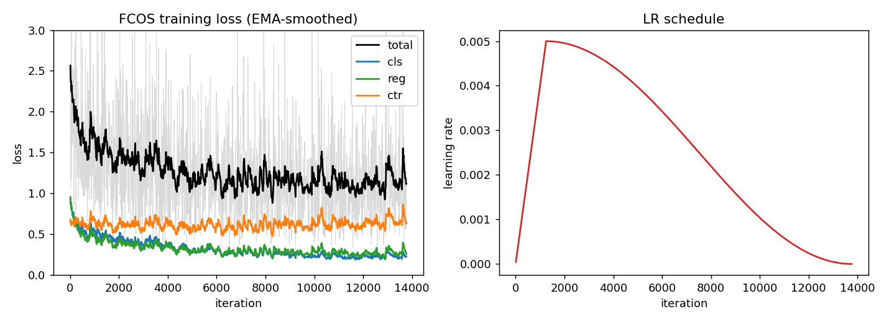
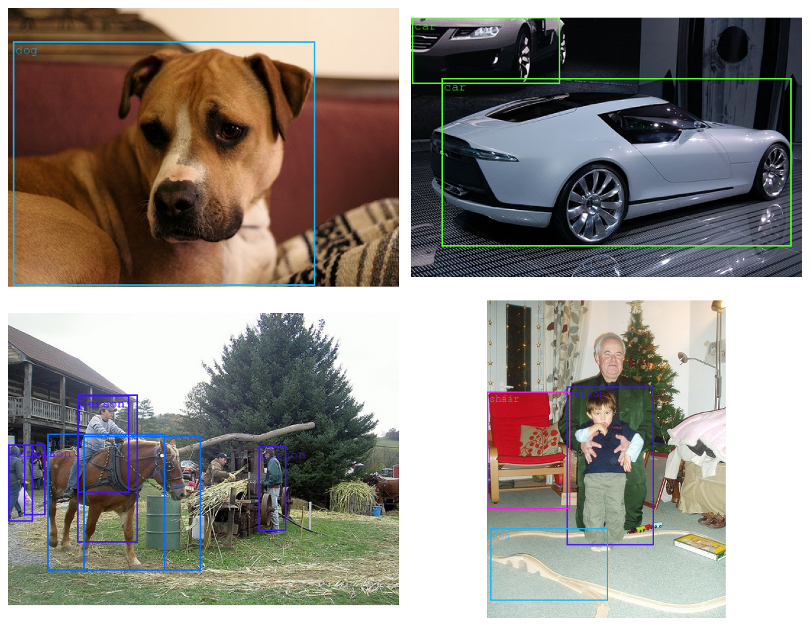

# BMI/CS 771 — Homework 2 Report

**Team:** Ashvin, Akshat, Shubhangi

---

## Part I — Image Classification (MiniPlaces)

### I.1 Custom CNN
*(Ashvin — model design, training scheme, results; include config, logs, final checkpoint.)*

### I.2 Self-Attention and Transformer Block

#### Multi-Head Self-Attention (MSA)
Self-attention computes a weighted representation of input tokens by measuring pairwise similarities between query and key projections. Given an input sequence of tokens $Z^0 \in \mathbb{R}^{T \times D}$ where $T = H \times W$ and $D$ is the embedding dimension, learnable linear projections produce queries, keys, and values:
$$Q = Z^0 W_Q, \quad K = Z^0 W_K, \quad V = Z^0 W_V$$
where $W_Q, W_K, W_V \in \mathbb{R}^{D \times D}$. For multi-head self-attention with $h$ heads, the channel dimension is split such that each head operates on vectors of dimension $d_k = D / h$. The attention matrix for each head computes scaled dot-product similarities followed by row-wise softmax:
$$S = \text{softmax}\left(\frac{Q K^T}{\sqrt{d_k}}\right) V$$
where $\frac{1}{\sqrt{d_k}}$ prevents vanishing gradients in the softmax for larger head dimensions. The outputs across all $h$ heads are concatenated along the feature dimension and projected back through an output linear layer $W_O \in \mathbb{R}^{D \times D}$.

In `cls_libs/modeling.py`, `Attention.forward` maps an input tensor of shape `(B, H, W, C)` to queries, keys, and values of shape `(B * num_heads, H * W, head_dim)`. After evaluating the scaled dot-product attention and multiplying by $V$, the resulting tensor is reshaped to `(B, num_heads, H, W, head_dim)`, permuted to `(B, H, W, num_heads, head_dim)`, flattened along the channel dimension back to `(B, H, W, C)`, and finally projected via `self.proj`.

#### Pre-LN Transformer Block with Local Window Self-Attention
While standard multi-head self-attention computes global interactions across all $T$ tokens with $\mathcal{O}(T^2 D + D^2 T)$ complexity, this quadratic cost becomes prohibitive for high-resolution vision tasks. To mitigate this, local window self-attention partitions tokens into non-overlapping spatial windows of size $W_w \times W_w$, bounding computational complexity to $\mathcal{O}(W_w^2 T D + D^2 T)$ where $W_w^2 \ll T$.

The block follows the Pre-LayerNorm (Pre-LN) design with stochastic depth regularization (DropPath):
$$x_1 = x_0 + \text{DropPath}\left(\text{WindowMSA}(\text{LN}_1(x_0))\right)$$
$$x_2 = x_1 + \text{DropPath}\left(\text{MLP}(\text{LN}_2(x_1))\right)$$
where the MLP consists of two linear layers with a GELU activation and expansion ratio `mlp_ratio = 4.0`.

When `window_size > 0`, the spatial feature map is partitioned into non-overlapping windows using `window_partition`, padding the boundaries if $H$ or $W$ is not divisible by $W_w$. Self-attention operates independently within each window. The tokens are then reassembled into the full spatial layout using `window_unpartition` before adding the residual connection. When `window_size = 0`, the block performs full global self-attention across all tokens.

### I.3 Vision Transformer

#### Architecture Design (`SimpleViT`)
`SimpleViT` adapts the plain Vision Transformer backbone design from ViTDet (Li et al., ECCV 2022) for MiniPlaces scene classification:
- **Patch Embedding**: Images of resolution $128 \times 128 \times 3$ are projected by non-overlapping $16 \times 16$ convolutions into a grid of $8 \times 8 = 64$ patch tokens of dimension $D = 192$.
- **Positional Embeddings**: Learnable absolute 2D positional embeddings of shape `(1, 8, 8, 192)` initialized with truncated normal distribution ($\sigma = 0.02$) are added directly to the patch tokens.
- **Interleaved Window & Global Attention Blocks**: We stack $L = 4$ Transformer blocks with $h = 4$ attention heads each. To balance computation and receptive field, blocks at indices `(0, 2)` use local window attention ($W_w = 4$), while blocks at `(1, 3)` perform global self-attention. This allows efficient local feature extraction while enabling global context propagation across windows.
- **Stochastic Depth**: DropPath rates are linearly decayed from $0.0$ to $0.10$ across the depth of the network.
- **Classification Head**: The output of the final block passes through a LayerNorm, followed by global average pooling across the $8 \times 8$ spatial tokens, and a linear classifier mapping the $192$-dimensional embedding to $100$ scene categories.

#### Training Scheme & Configuration
- **Dataset**: MiniPlaces ($128 \times 128$ crops, random horizontal flip, color jitter 0.15, random rotation $\pm 15^\circ$, normalized with ImageNet statistics).
- **Optimizer**: AdamW with learning rate $1 \times 10^{-3}$, weight decay $0.05$, and batch size $512$.
- **Scheduler**: 1 warmup epoch with linear warmup followed by cosine annealing over 60 epochs.
- **Precision**: Mixed precision (FP16 GradScaler) when running on CUDA.
- **Parameter Decay**: All linear and convolutional layer weights receive weight decay; 1D normalization weights, biases, and positional embeddings are explicitly excluded from weight decay.

### I.4 Comparison
*(Best CNN vs. provided SimpleNet vs. fine-tuned ResNet-18 — training curves and top-1/top-5 accuracy.)*

---

## Part II — Object Detection (FCOS)

We implemented FCOS, an anchor-free one-stage detector. The starter code provides the ResNet backbone, FPN with extra P6/P7 levels, the shared heads, the point generator, and the train/eval pipeline. We filled in the two missing components in `det_libs/modeling.py`: inference and the training loss.

### II.1 Inference

Inference runs per image. For each FPN level we compute an object score of `sqrt(sigmoid(cls) · sigmoid(center-ness))`, drop candidates below `score_thresh = 0.1`, and keep the top 1000 by score. The regression head predicts the four distances `(l, t, r, b)` to the box sides in grid units, so we scale them by the level stride and form each box as `(x−l, y−t, x+r, y+b)` around the point. Boxes are clipped to the image and tiny boxes removed. We then merge all levels, apply per-class NMS (`nms_thresh = 0.6`), and keep the 100 highest-scoring detections. Class indices are shifted by `+1` to reverse the label offset applied at data loading.

On the provided pretrained ResNet-18 model (VOC 2007 test):

| Metric | Result |
|--------|--------|
| mAP@0.5 | 0.609 |
| mAP@[0.5:0.95] | 0.330 |
| Inference time | ~146 s |

This matches the expected 60.9%, confirming the decoding is correct.

### II.2 Training Loss

For each image we assign targets to every feature point, vectorized over points × GT boxes. A point is positive for a box when it falls inside a center-sampling window (`1.5 × stride`, clamped to the box) and the largest of its four distances lies within that level's regression range. Points matching several boxes take the smallest-area one.

Three losses, each normalized by a running mean of the positive count:
- **Classification** — sigmoid focal loss (α=0.25, γ=2) over all points.
- **Regression** — GIoU over positive points, between decoded and ground-truth boxes.
- **Center-ness** — BCE over positive points, target `sqrt((min(l,r)/max(l,r))·(min(t,b)/max(t,b)))`.

Training settings (default config):

| | |
|---|---|
| Backbone | ResNet-18, ImageNet-pretrained, BN frozen |
| Neck | FPN (256-d) + P6/P7, strides [8,16,32,64,128] |
| Input | scale jitter {256,288,320}, max side 480 |
| Optimizer | SGD, momentum 0.9, weight decay 1e-4 |
| LR | 5e-3, cosine, 1 warmup epoch |
| Epochs / batch | 10 (+1 warmup) / 4 |
| GPU | single T4 |

Training took about 24 minutes. The total loss fell from roughly 2.5 to 1.1; classification and regression settle near 0.25 and center-ness near 0.6.

*Figure 1: Training losses (total, classification, regression, center-ness) and the warmup–cosine learning-rate schedule.*

Results on VOC 2007 test:

| Metric | Ours | Pretrained |
|--------|------|------------|
| mAP@0.5 | 0.593 | 0.609 |
| mAP@[0.5:0.95] | 0.321 | 0.330 |
| mAP@0.75 | 0.312 | 0.322 |
| AP small/med/large | 0.046 / 0.169 / 0.409 | 0.078 / 0.201 / 0.406 |

Our model reaches 59.3% mAP@0.5, about 1.6 points below the pretrained reference. The difference comes from a lighter schedule — batch 4, lr 5e-3, 10 epochs, 480-px input versus the reference's batch 32, lr 0.02, 12 epochs, 640-px input. Accuracy is highest on large objects and lowest on small ones, as expected at this input resolution.

*Figure 2: Sample detections on the test set, showing correct localization across categories and scene types.*

---

## Contributions
- **Akshat** — Object detection (FCOS inference and training loss), repository/infra setup.
- **Ashvin** — *(classification CNN)*
- **Shubhangi** — Multi-head self-attention (`Attention`), local-window Pre-LN Transformer block (`TransformerBlock`), and Vision Transformer architecture (`SimpleViT`) implementation and writeup.

## Additional packages
Beyond the required packages, we used: `opencv-python-headless`, `matplotlib` (for plots), and `fonts-freefont-ttf` (so `eval_det.py -v` can render label fonts on a headless server).
